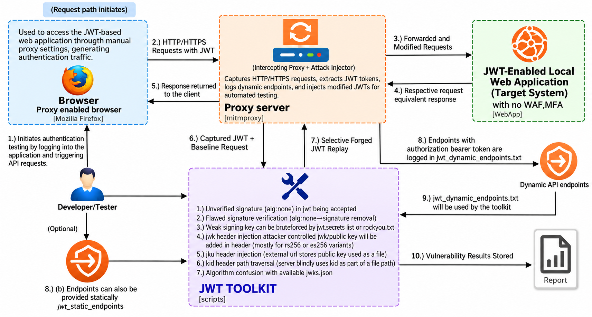
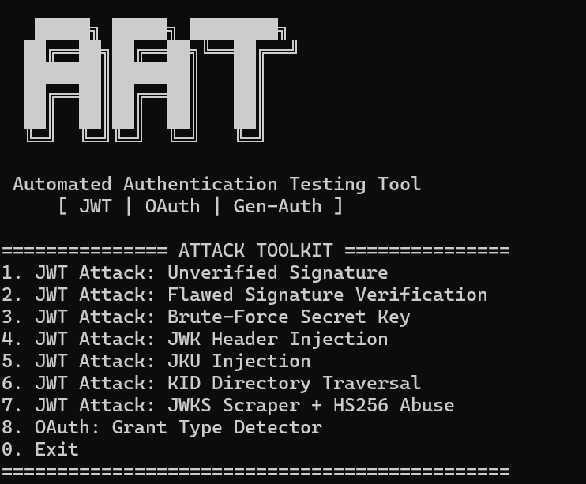

# Automated Authentication Testing Tool (AAT)

**A Python and mitmproxy-based toolkit for inspecting JWT authentication security and identifying OAuth 2.0 authorization flows.**

AAT provides a terminal menu that launches eight independent mitmproxy addons. Seven modules explore common JWT implementation weaknesses, while the eighth observes OAuth 2.0 grant types in proxied traffic. 
## Table of contents

1. [Overview](#overview)
2. [Key features](#key-features)
3. [Architecture and workflow](#architecture-and-workflow)
4. [Project structure](#project-structure)
5. [Technology stack](#technology-stack)
6. [Prerequisites and installation](#prerequisites-and-installation)
7. [Running the toolkit](#running-the-toolkit)
8. [Module-by-module explanation](#module-by-module-explanation)
9. [Results and interpretation](#results-and-interpretation)
10. [Current implementation limitations](#current-implementation-limitations)

## Overview

Web applications commonly use **JSON Web Tokens (JWTs)** for bearer-token authentication and **OAuth 2.0** for delegated authorization. Authentication implementations can become vulnerable when applications trust attacker-supplied token headers, accept unsigned tokens, use guessable signing secrets, or select verification keys insecurely.

AAT uses **mitmproxy** to observe HTTP(S) requests and responses and, in selected modules, modify JWTs in proxied requests. The project aims to make these security checks accessible through a single terminal interface.

**Scope of the current code:** JWT header and signing-key checks; JWKS endpoint discovery; OAuth grant-type and token-issuance observation. It does **not** currently provide a full OAuth redirect URI, state, PKCE validation, or account-takeover test suite.

## Key features

- Menu-driven launcher with eight individually selectable modules.
- mitmproxy request and response hooks for inspecting authentication traffic.
- JWT extraction from bearer Authorization headers and, in several modules, cookies.
- Unsigned JWT (`alg: none`) checks.
- Wordlist-based verification of HMAC signing secrets.
- RSA JWT embedded-JWK and `jku` header testing.
- `kid` path-traversal header mutation.
- JWKS discovery and RS-to-HS algorithm-confusion experimentation.
- OAuth 2.0 authorization-flow and grant-type observation.
- Timestamped text logs and static/dynamic endpoint tracking in supported modules.

## Architecture and workflow

The following architecture diagram illustrates the interaction between the AAT launcher, selected mitmproxy addon, browser or test client, target application, and analysis outputs.



*Figure 1: System Architecture of the Automated Authentication Testing Tool (AAT).*


**How a typical test works:**

1. Start AAT and select one module.
2. The launcher starts mitmproxy with that addon on port `8080`.
3. Configure a browser or test HTTP client to use the proxy.
4. Browse or exercise an **authorized** JWT-protected endpoint or OAuth login flow.
5. The addon observes requests; some addons generate or inject a modified JWT.
6. The addon records findings when its test conditions are met.
7. Stop mitmproxy, review the output, and independently validate any apparent vulnerability.

**Important:** The current launcher runs **one addon at a time**; selecting a module does not run all eight checks automatically. Traffic must actually pass through the proxy, and most modules require a suitable JWT-bearing request.

## Project structure

```text
Generic/
└── Generic/
    ├── main.py                          # Interactive launcher
    ├── script1.py                       # Unsigned JWT check
    ├── script2.py                       # Unsigned JWT verification check
    ├── script3.py                       # Weak HMAC secret wordlist check
    ├── script4.py                       # Embedded JWK header injection
    ├── script5.py                       # JKU header injection
    ├── script6.py                       # kid path traversal mutation
    ├── script7.py                       # JWKS discovery / algorithm confusion
    ├── script8.py                       # OAuth grant type detector
    ├── images/
    │   ├── aat-architecture.png
    │   └── aat-toolkit-execution.png
    ├── jwt.secrets.list                 # Candidate JWT HMAC secrets
    ├── jwt_endpoints_static.txt         # Existing endpoint list
    ├── jwt_endpoints_dynamic.txt        # Observed endpoint log
    ├── jwt_attack_results_script1.txt   # Existing output
    ├── jwt_attack_results_script2.txt   # Existing output
    ├── jwt_attack_results_script3.txt   # Existing output
    ├── jwt_attack_results_script4.txt   # Existing output
    └── __pycache__/                     # Generated Python bytecode
```

The ZIP does **not** contain `private_key.pem`, a `requirements.txt`, or pre-existing result files for every module. Modules may create additional result files when run. `__pycache__/` should generally not be committed to version control.

## Technology stack

| Component | Purpose |
|---|---|
| Python 3 | Main programming language |
| mitmproxy | Intercepting proxy and addon event hooks |
| PyJWT (`jwt`) | JWT parsing, signing, and verification |
| cryptography | RSA key serialization and key operations |
| requests | HTTP requests for JWKS discovery in module 7 |
| Standard library | JSON, Base64, URL parsing, logging, subprocesses, timestamps |
| Plain text files | Endpoint lists, candidate secrets, and result logs |

## Prerequisites and installation

### 1. Extract the archive

Open a terminal in the inner `Generic/Generic` folder, where `main.py` and `script1.py` through `script8.py` are located. The launcher uses relative script paths.

### 2. Create a virtual environment

```bash
python3 -m venv .venv
source .venv/bin/activate
```

### 3. Install dependencies

```bash
python -m pip install mitmproxy PyJWT cryptography requests
```

These are the packages imported by the supplied scripts. The archive does not provide pinned dependency versions; compatibility should be tested in your environment.

### 4. Check the installation

```bash
mitmproxy --version
python -c "import mitmproxy, jwt, cryptography, requests; print('Imports successful')"
```

### 5. Configure the test client

The launcher binds mitmproxy to port **8080**. Set your browser or HTTP client to use the local proxy at `127.0.0.1:8080`. To inspect HTTPS traffic, follow the official mitmproxy certificate setup instructions for your test browser/device: <https://docs.mitmproxy.org/stable/>.

Do not install a testing proxy certificate on a shared or untrusted device.

### 6. Optional RSA key for modules 4 and 5

These modules load `private_key.pem` from the current working directory. Generate a **dedicated laboratory key** if you intend to run them:

```bash
openssl genpkey -algorithm RSA -pkeyopt rsa_keygen_bits:2048 -out private_key.pem
```

This key alone does **not** make a JWK or JKU test successful: the target's JWT verification behavior, key distribution, and trust configuration determine the result. Never use a production private key or commit a private key to a repository.

## Running the toolkit

To launch the Automated Authentication Testing Tool (AAT), open a terminal in the project directory containing `main.py` and execute:

```bash
python main.py
```

Once executed, the toolkit displays an interactive command-line interface containing eight testing modules for JWT and OAuth authentication security.



*Figure 2: Interactive command-line interface of the Automated Authentication Testing Tool (AAT).*

Select a module by entering its corresponding number (`1`–`8`), then generate suitable test traffic through the proxy. Exit mitmproxy (normally `q` in its terminal interface) to return to the launcher. Enter `0` to exit AAT.

**Alternative for debugging an individual addon:**

```bash
mitmproxy -p 8080 -s script8.py
```

Substitute the script number as needed. JWT-mutating modules can change authentication requests, so use them only with systems you are authorized to test.

## Module-by-module explanation

### Module 1 — Unverified JWT signature (`script1.py`)

**Security concept:** A correctly configured JWT verifier must reject tokens with an unexpected or unsigned `alg` value when a signed token is required.

**Implementation:** Reads a JWT from a bearer header or cookie, decodes its header, changes `alg` to `none`, removes `kid`, and constructs a token with an empty signature. It records the initial response per HTTP method/path and injects the modified token into later proxied traffic. Responses are assessed using status codes and authentication-error keywords.

**Output:** `jwt_attack_results_script1.txt`; dynamic endpoints may be appended to `jwt_endpoints_dynamic.txt`.

**Caution:** The module uses a global modified token, can overwrite multiple cookies, and does not cryptographically prove that a protected action succeeded. A `200 OK` response may be a public page, error page, or login page.

### Module 2 — Flawed signature verification (`script2.py`)

**Security concept:** Servers must validate JWT signatures and reject unsigned replacements.

**Implementation:** Also creates an `alg: none` JWT. Unlike module 1, it tracks mutation in mitmproxy flow metadata and produces a single verdict for the first tested modified response. It tracks endpoints when an Authorization header is present.

**Output:** `jwt_attack_results_script2.txt` and potentially `jwt_endpoints_dynamic.txt`.

**Caution:** Despite its different name, the implemented payload overlaps substantially with module 1. It does not currently exercise a comprehensive set of signature-verification flaws.

### Module 3 — Weak HMAC signing-secret detection (`script3.py`)

**Security concept:** HS256, HS384, and HS512 rely on a shared secret. A guessable secret may allow unauthorized token signing.

**Implementation:** Extracts a JWT, identifies its declared algorithm, and—only for supported HMAC algorithms—tries candidate secrets from `jwt.secrets.list` by verifying the token with PyJWT. It avoids repeating the same token/algorithm pair. RSA and ECDSA algorithms are not subjected to HMAC wordlist testing.

**Output:** `jwt_attack_results_script3.txt`.

**Caution:** Failure to find a secret in the supplied list does **not** establish that the signing secret is strong. A found secret is written in plaintext to the result file, so treat reports as sensitive. This module checks the signature offline; it does not need to alter the outgoing request.

### Module 4 — Embedded JWK header injection (`script4.py`)

**Security concept:** Some JWT implementations may incorrectly trust a public verification key embedded in an untrusted token header (`jwk`).

**Implementation:** For RSA-signed tokens, loads `private_key.pem`, derives its public-key parameters, embeds a JWK in the JWT header, and signs a replacement JWT with the test private key. It uses `jwt_endpoints_static.txt` as an optional endpoint filter and evaluates later responses.

**Output:** `jwt_attack_results_script4.txt`.

**Caution:** The private key is missing from the archive. The current response/baseline handling can produce premature or misleading verdicts, and non-401/403 responses do not establish successful authentication. The static endpoint file must contain paths matching the request path format expected by this script.

### Module 5 — JKU header injection (`script5.py`)

**Security concept:** A verifier that fetches signing keys from an attacker-controlled `jku` URL without appropriate trust restrictions may be vulnerable to key substitution.

**Implementation:** For RSA JWTs, signs a replacement token with `private_key.pem` and inserts a `jku` URL assembled from the observed request origin and a predefined set of possible JWKS paths. It tracks baseline response status/size and logs later behavior.

**Output:** `jwt_attack_results_script5.txt` and potentially `jwt_endpoints_dynamic.txt`.

**Caution:** The current code does **not** host an attacker-controlled JWKS endpoint or verify that the target actually fetched the specified key. It also selects the first successfully constructed candidate rather than systematically exercising every JWKS path. Response-size changes alone cannot confirm JKU exploitation.

### Module 6 — `kid` path traversal (`script6.py`)

**Security concept:** The JWT `kid` header identifies a signing key. Unsafe use of that value as a file path may lead to path traversal or incorrect key selection.

**Implementation:** Rewrites the `kid` field with a path-traversal candidate such as `../../../dev/null` while retaining the original signature bytes. It observes subsequent responses and tracks dynamic endpoints.

**Output:** `jwt_attack_results_script6.txt` and potentially `jwt_endpoints_dynamic.txt`.

**Caution:** Changing the header normally invalidates the original signature. The script currently attempts only the first successfully constructed candidate and does not prove which key the server selected. Its baseline/test association and verdict heuristics need improvement.

### Module 7 — JWKS discovery and RS-to-HS algorithm confusion (`script7.py`)

**Security concept:** In an algorithm-confusion flaw, a verifier may incorrectly treat an RSA public key as an HMAC shared secret after accepting an attacker-chosen algorithm.

**Implementation:** Inspects JWT headers and payloads, attempts unsigned-token testing, discovers public keys from common JWKS locations, converts RSA JWK parameters into a public-key representation, and includes an RS-to-HS token-generation path. It annotates requests using `X-JWT-Test` and compares responses against a stored baseline.

**Output:** `jwt_generic_results_script7.txt` (created during execution).

**Caution:** The current request logic prioritizes `alg: none`, so the RS-to-HS branch is generally unreachable for normal signed JWTs when unsigned-token generation succeeds. Modern PyJWT versions may also reject PEM-formatted asymmetric keys used as HMAC secrets. This module requires refactoring and validation before claiming reliable algorithm-confusion coverage.

### Module 8 — OAuth 2.0 grant-type detector (`script8.py`)

**Security concept:** OAuth 2.0 supports several authorization and token-exchange patterns. Identifying them helps an assessor understand the application's authentication architecture and where to focus subsequent checks.

**Implementation:** Passively examines proxied authorization requests, token requests, and JSON token responses. It recognizes `response_type`, `code_challenge`, and `grant_type` parameters, plus token-issuance indicators.

**Recognized observations include:**

- Authorization Code and Authorization Code with PKCE.
- Implicit flow.
- Refresh Token, Client Credentials, and Resource Owner Password Credentials.
- Device Code, JWT Bearer, and SAML Bearer grants.
- Unknown grant-type values.
- Access-token and access-plus-refresh-token issuance.
- Heuristically inferred client-credentials usage from Basic authentication at a token endpoint.

**Output:** `grant_type_results.txt`, including a summary when the addon stops.

**Caution:** This module is a detector, **not** a complete OAuth security scanner. A detected flow is not automatically a vulnerability; PKCE presence does not establish correct PKCE enforcement. Token-issuance observations are reported alongside grant types even though they are not themselves OAuth grants.

## Results and interpretation

Most JWT modules append timestamped records to text files, typically including the attack name, request method/path, HTTP status, response size, result, verdict, and confidence level. Module 3 logs signing-key verification details instead of an HTTP response; module 8 uses its own structured OAuth observation format.

Example of the **format** of a JWT finding (illustrative, not an observed result):

```text
[YYYY-MM-DD HH:MM:SS]
ATTACK: JWT alg:none
METHOD: GET
URL: /api/profile
STATUS: 401
RESPONSE_SIZE: 84 bytes
RESULT: JWT alg:none rejected
VERDICT: NOT VULNERABLE
CONFIDENCE: HIGH
------------------------------------------------------------
```

### Understanding verdicts

| Verdict | Meaning in the current implementation |
|---|---|
| `VULNERABLE` | A script's detection condition was met; **manual confirmation required** |
| `POTENTIALLY VULNERABLE` | Response behavior may justify further investigation |
| `NOT VULNERABLE` | This particular test did not demonstrate the weakness; not proof of overall security |
| Confidence | A script-assigned heuristic label, not a validated probability or formal severity rating |

To verify a suspected finding, compare the original and modified requests against the **same protected endpoint**, establish the expected unauthorized response, and check whether the modified request actually gained access to a protected resource or action. Do not rely on HTTP status alone.

### Endpoint files

- `jwt_endpoints_static.txt` is an existing path list used by certain modules to filter traffic. Its expected format is not entirely consistent across modules.
- `jwt_endpoints_dynamic.txt` collects observed method/path entries in modules that implement dynamic logging.

These files are not a complete automatic API inventory. Endpoint logs and result files may contain sensitive path names, parameters, or secrets; review them before sharing.

## Current implementation limitations

The following limitations were identified directly in the supplied code:

1. **Single-addon execution:** The launcher runs one module at a time, not an end-to-end automated scan.
2. **Overlapping tests:** Modules 1 and 2 both implement `alg: none` testing.
3. **Missing key material:** Modules 4 and 5 expect `private_key.pem`, absent from the ZIP.
4. **Heuristic verdicts:** Status codes, body keywords, and response-size changes can produce false positives and false negatives.
5. **Global mutable state:** Several addons reuse one forged token across requests and endpoints, making multi-user/multi-host traffic unreliable.
6. **Baseline issues:** Some modules compare responses that are not guaranteed to represent an original-versus-modified request pair.
7. **Incomplete candidate coverage:** Modules 5 and 6 do not exhaustively test all defined candidate paths/payloads.
8. **Module 7 branch issue:** The unsigned-token test can prevent the algorithm-confusion branch from running.
9. **Endpoint-filter inconsistency:** Static endpoint matching differs between modules; some expect path-only values, while other logic compares raw lines.
10. **No automated test suite:** The ZIP does not include unit/integration tests or reproducible benchmark results.
11. **No configuration/packaging:** Port, filenames, and some test parameters are hard-coded; dependency versions are not pinned.
12. **OAuth observation only:** Module 8 does not verify redirect URI validation, `state`, PKCE verifier enforcement, or authorization-code replay protections.
13. **Sensitive output:** The weak-secret module logs discovered secrets directly.

These are known development gaps, not evidence that any particular target is vulnerable.
"# Automation-Authentication-Testing-Tool-AAT-" 
